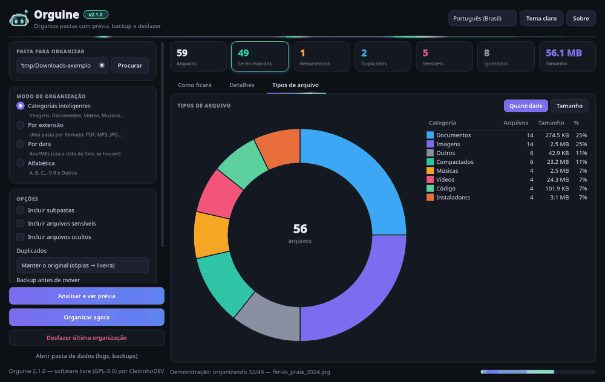
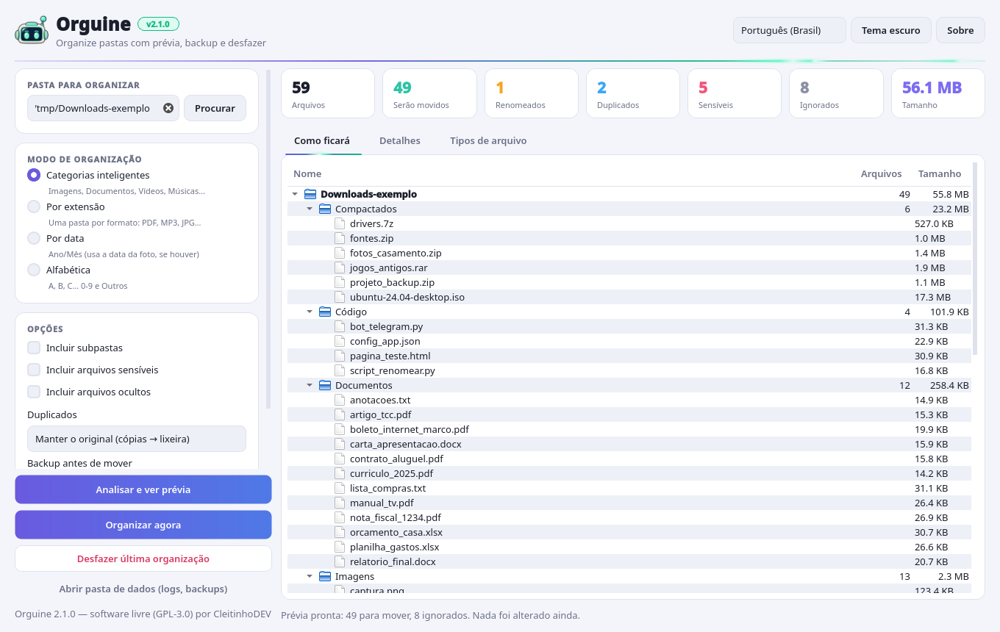
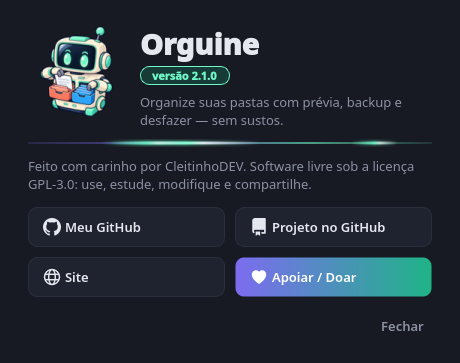
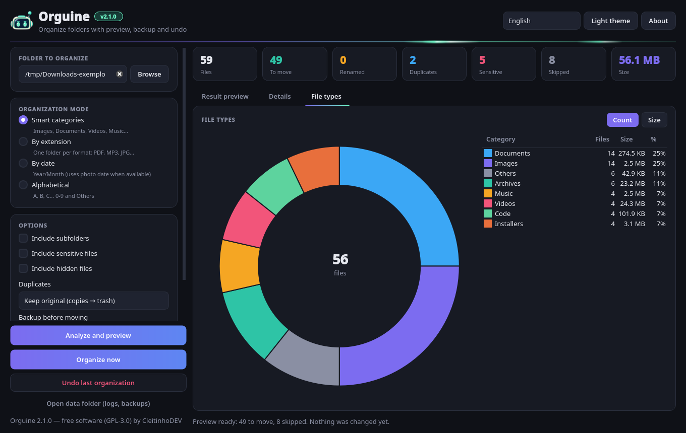

<p align="center">
  
</p>

<h1 align="center">Orguine</h1>

<p align="center">
  <b>Organize suas pastas com prévia, backup e desfazer — sem sustos.</b><br>
  <a href="https://github.com/cleitinhodev/orguine/actions/workflows/ci.yml"></a>
  
  
</p>

<p align="center">
  <a href="https://github.com/cleitinhodev">Meu GitHub</a> ·
  <a href="https://github.com/cleitinhodev/orguine">Projeto</a> ·
  <a href="https://www.bugzinho.com/">Site</a> ·
  <a href="https://www.bugzinho.com/donate">💚 Apoiar / Doar</a>
</p>

O **Orguine** arruma pastas bagunçadas (como **Downloads** ou **Área de Trabalho**) em poucos cliques,
**mostrando antes como tudo vai ficar**. Tem backup, desfazer, proteção de arquivos sensíveis e
tratamento de duplicados. Interface em **português (Brasil)** e **inglês**. *English version below.*



| Prévia "como ficará" (tema claro) | Sobre |
|---|---|
|  |  |

> O Orguine é a evolução do antigo **Organize Files** (os scripts originais estão em [`legacy/`](legacy/)).

## ✨ Funcionalidades

- **Prévia "como ficará"**: uma árvore com as pastas que serão criadas e o que vai para cada uma. **Nada é movido antes de você confirmar.**
- **Gráfico de tipos de arquivo**: gráfico de rosca por categoria, por quantidade ou por tamanho, com legenda e porcentagens.
- **Tabela de detalhes** com busca e filtros (renomeados, duplicados, sensíveis, ignorados) e o motivo de cada decisão.
- **4 modos de organização**:
  - **Categorias inteligentes**: Imagens, Documentos, Vídeos, Músicas, Compactados, Código, Instaladores…
  - **Por extensão**: uma pasta por formato (PDF, MP3…).
  - **Por data**: Ano/Mês. Para fotos, usa a data EXIF quando ela existe.
  - **Alfabética**: A–Z, 0-9 e Outros.
- **Duplicados**: detectados por conteúdo (SHA-256, não só pelo nome). Você escolhe entre manter o original e enviar as cópias para a **lixeira**, apenas pular, manter o mais novo, ou ignorar.
- **Subpastas (opcional)**: pastas de projetos (`.git`, `package.json`, `pyproject.toml`…) nunca são desmontadas.
- **Trabalho em segundo plano**: análise e organização rodam em uma *thread*, com barra de progresso e botão **Cancelar**, e a janela não trava.
- **Desfazer a última organização** com um clique.
- **Visual neon**: a cor **#6ff8c8** do robozinho combinada ao roxo do tema. Faixas de luz correm na linha do cabeçalho, na aba ativa e na barra de progresso; os botões principais ganham um reflexo, e os cartões brilham ao passar o mouse. As animações usam um único temporizador leve (~30 fps), **pausam com a janela minimizada** e podem ser desligadas em **Opções → Animações neon** (ou com `ORGUINE_NO_ANIM=1`).
- **Tema claro/escuro**, arrastar e soltar uma pasta na janela, e preferências salvas.
- **Linha de comando (CLI)** para usar em scripts.

## 🛡️ Segurança em camadas

O antigo Organize Files 1.x podia **sobrescrever arquivos com o mesmo nome** e não tinha como voltar atrás. Agora:

1. **Nunca sobrescreve**: se o destino já existir, o arquivo vira `nome (1).ext`, `nome (2).ext`… (sem diferenciar maiúsculas de minúsculas, como no Windows/macOS).
2. **Pastas perigosas são bloqueadas**: raiz do disco, `C:\Windows`, `Program Files`, `AppData`, `/usr`, `/etc`, `/System`, `~/Library`, `~/.ssh`, `~/.config`… Organizar a **pasta pessoal inteira** exige digitar `ORGANIZAR` para confirmar.
3. **Arquivos sensíveis ficam no lugar**: chaves (`id_rsa`, `.pem`, `.pfx`), `.env`, cofres de senha (`.kdbx`), carteiras, bancos de dados e nomes como "senha" ou "password" **não são movidos por padrão**. Se você decidir incluí-los, aparece um **aviso listando cada um**.
   
4. **Arquivos sensíveis nunca vão para a lixeira** como "duplicados", a menos que você permita explicitamente (CLI: `--permitir-lixeira-sensiveis`).
5. **Arquivos de sistema, ocultos e temporários são ignorados**: `desktop.ini`, `.DS_Store`, `Thumbs.db`, downloads incompletos (`.crdownload`, `.part`) e atalhos. O próprio executável do programa também nunca é movido.
6. **Backup opcional antes de mover**: um **ZIP** ou uma **cópia da pasta**, guardado na pasta de dados do app.
7. **Diário de desfazer**: cada movimentação é registrada em JSON, salvo de forma atômica durante a execução. Se o programa fechar no meio, o desfazer ainda funciona.
8. **Exclusões vão para a lixeira do sistema** (via Send2Trash), nunca são apagadas direto.
9. **Log detalhado** de tudo o que foi feito, com rotação automática.

## 🚀 Como usar

### Executável pronto
Baixe o arquivo do seu sistema em **[Releases](https://github.com/cleitinhodev/orguine/releases)** ou na aba
**[Actions](https://github.com/cleitinhodev/orguine/actions)** (artefatos do último build):
`Orguine-windows-amd64.exe`, `Orguine-macos-*.zip` (app) ou `Orguine-linux-x86_64`.

> No macOS o app não é assinado. Na primeira vez, abra com **botão direito → Abrir**.
> No Windows, o SmartScreen pode avisar por ser um executável novo e sem assinatura: **Mais informações → Executar assim mesmo**.

### A partir do código-fonte (Python 3.10+)
```bash
git clone https://github.com/cleitinhodev/orguine.git
cd orguine
python -m venv .venv
# Windows: .venv\Scripts\activate   |   Linux/macOS: source .venv/bin/activate
pip install -e ".[exif]"        # ou: pip install -r requirements.txt
python -m orguine               # abre a interface
```

### Linha de comando
```bash
# só ver a prévia (não mexe em nada)
python -m orguine ~/Downloads --dry-run

# organizar por categoria, com backup ZIP e duplicados para a lixeira
python -m orguine ~/Downloads --backup zip --duplicados trash

# por data (ano/mês), incluindo subpastas, sem perguntar
python -m orguine ~/Fotos --modo data --recursivo --sim

# desfazer a última organização
python -m orguine --desfazer
```
Modos: `categoria` (padrão), `extensao` (ou `tipo`), `data`, `abc`. Veja todas as opções com `--help`.
Depois de `pip install`, os comandos `orguine` (interface) e `orguine-cli` também ficam disponíveis.

## ⚙️ Personalizar categorias
Copie [`orguine/resources/default_rules.json`](orguine/resources/default_rules.json) para
`rules.json` dentro da **pasta de dados** e edite os nomes, as cores e as extensões. Na CLI, também dá para usar `--regras arquivo.json`.

**Pasta de dados** (diários de desfazer, backups, logs e `rules.json`). O botão "Abrir pasta de dados" na interface abre essa pasta:

| Sistema | Local |
|---|---|
| Windows | `%APPDATA%\Orguine` |
| macOS | `~/Library/Application Support/Orguine` |
| Linux | `~/.local/share/orguine` (ou `$XDG_DATA_HOME`) |

Para trocar o local, defina a variável `ORGUINE_DATA_DIR`.

## 🧑‍💻 Desenvolvimento
```bash
pip install -e ".[dev]"
pytest -q                       # no Linux sem tela: QT_QPA_PLATFORM=offscreen pytest -q
python scripts/build_exe.py     # gera o executável em dist/ (PyInstaller)
```

Estrutura do projeto:
```
orguine/
├── core/         # lógica sem interface (testável)
│   ├── planner.py     # monta o plano / prévia
│   ├── executor.py    # executa o plano e desfaz
│   ├── safety.py      # pastas bloqueadas, sensíveis, ocultos
│   ├── duplicates.py  # SHA-256 em etapas (tamanho → início → completo)
│   ├── journal.py     # diário de desfazer
│   ├── backup.py      # ZIP / cópia
│   └── rules.py, naming.py, dates.py, hashing.py, models.py
├── gui/          # PySide6: janela, prévia, gráfico, tema, efeitos neon, "Sobre", workers (QThread)
├── cli.py        # linha de comando
├── i18n.py       # textos pt-BR / en
└── resources/    # regras padrão e ícones (orguine_icon: app/executável; orguine_favicon: cabeçalho)
tests/            # pytest + pytest-qt
legacy/           # Organize Files 1.x (CustomTkinter), só para referência
```

O **GitHub Actions** roda os testes no Windows, no macOS e no Linux e gera os executáveis com PyInstaller
(e confere se o ícone ficou embutido no `.exe`). Uma tag `v*` publica tudo como Release.

## 💚 Apoie
Se o Orguine te ajudou, considere [apoiar o projeto](https://www.bugzinho.com/donate). Visite também [bugzinho.com](https://www.bugzinho.com/).

## 📄 Licença
[GPL-3.0](LICENSE) © CleitinhoDEV

---

# 🇺🇸 English

**Orguine** tidies up messy folders (Downloads, Desktop…) and **shows you the result before anything is moved**.
It is built with **PySide6 (Qt 6)** and has an English and Brazilian Portuguese UI. It grew out of the old *Organize Files* project.



**Features**
- A **"Result preview" tree**, a details table with filters, and a **file-type donut chart** (by count or size).
- **Modes**: smart categories, by extension, by date (Year/Month, using EXIF for photos), and alphabetical.
- **Duplicate detection** by content (SHA-256). Copies can go to the **system trash**, be skipped, or keep only the newest file.
- Optional recursion, which never breaks apart project folders (`.git`, `package.json`…).
- A background worker (QThread) with progress and **Cancel**. **One-click undo**. Light and dark themes. Drag and drop.
- **Neon look**: the robot's **#6ff8c8** blended with the purple theme. Light streaks run along the header line, the active tab and the progress bar; primary buttons get a shine sweep and cards glow on hover. The animations run on a single light timer, pause while the window is minimized, and can be turned off under **Options → Neon animations** (or with `ORGUINE_NO_ANIM=1`).
- A **CLI**: `python -m orguine <folder> [--dry-run] [--modo categoria|extensao|data|abc] [--backup zip|folder] [--duplicados trash|skip|newest] [--desfazer]`.

**Safety**
- Files are never overwritten (`name (1).ext`).
- System and root folders are blocked. Organizing your whole home folder requires typed confirmation.
- Sensitive files (keys, `.env`, password vaults, wallets…) are left in place by default. Including them shows a warning with the full list, and they are never trashed as duplicates unless you explicitly allow it.
- System, hidden, temporary, and partial-download files are skipped.
- Optional ZIP or folder backup. An atomic undo journal. Deletions only go to the trash. Rotating logs.

**Download**: grab the build for your system from [Releases](https://github.com/cleitinhodev/orguine/releases) or the latest [Actions](https://github.com/cleitinhodev/orguine/actions) run.

**Run from source**
```bash
pip install -e ".[exif]"
python -m orguine          # GUI
python -m orguine --help   # CLI
```
Custom categories: copy `orguine/resources/default_rules.json` to `rules.json` in the app data folder
(`%APPDATA%\Orguine`, `~/Library/Application Support/Orguine`, or `~/.local/share/orguine`).

**Development**: `pip install -e ".[dev]" && pytest -q`. To build: `python scripts/build_exe.py`.
CI runs the tests and builds Windows, macOS, and Linux executables.

**Links**: [My GitHub](https://github.com/cleitinhodev) · [Project](https://github.com/cleitinhodev/orguine) · [Website](https://www.bugzinho.com/) · [Support / Donate](https://www.bugzinho.com/donate)

License: GPL-3.0 © CleitinhoDEV
